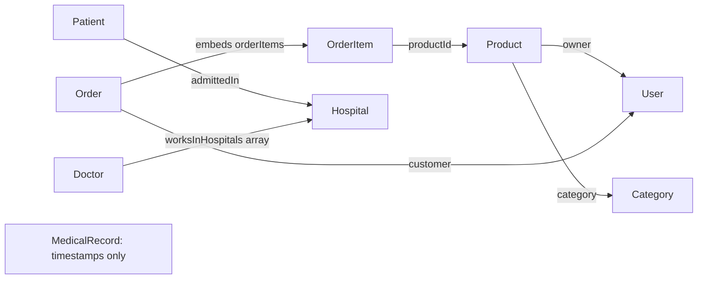

# Concepts explained

This guide follows the supplied lesson. Paths below are relative to E-commerce. Verification-only code is identified explicitly.

## 1. Model the information before writing application behavior

**What:** Data modeling means deciding which facts to store, their types, and how records relate. **Why:** At 3:06:48–3:08:25 the instructor explains that identifying data points first makes the application easier to build. **How:** List independent entities first, then entities depending on them: User and Category before Product, then Order (3:13:50–3:14:29). **Where:** `models/ecommerce/` follows this separation; the hospital exercise repeats it with a different domain.

An E-commerce user needs a username and email. A patient needs diagnosis and admission information. Calling both people “users” does not mean their schemas should have identical fields (3:42:32–3:46:27).

## 2. Schema, model, document and collection

**What:** A schema describes a record's shape. A model is the class compiled from it. A document is one instance; a collection stores documents. **Why:** Shared definitions make data consistent. **How:** `new mongoose.Schema({...}, {...})` defines fields and options; `mongoose.model('Category', categorySchema)` registers the model. **Where:** Every `*.models.js` file, particularly `models/ecommerce/category.models.js` (3:14:36–3:17:17).

```js
import { Category } from './models/index.js';
const category = new Category({ name: 'Books' });
await category.validate(); // Offline validation; not a database insert.
```

The instructor calls Schema a method; in the shown `new` expression it is used as a constructor. Its second options object supports more than timestamps. Model names conventionally use singular PascalCase; Mongoose normally derives lowercase plural collection names, so `Category` uses `categories`. This naming is performed by Mongoose, not MongoDB automatically interpreting English names. Registration names and `ref` strings must match. See the [official schema guide](https://mongoosejs.com/docs/guide.html).

## 3. Field types, required values, lowercase and defaults

**What:** `String`, `Number` and `ObjectId` describe accepted values; options refine behavior. **Why:** A product needs a usable name and a price with numeric behavior. **How:** `required: true` rejects a missing required field; `lowercase: true` transforms text; `default: 0` supplies a missing value. **Where:** User username/email/password (3:12:08–3:13:33), Product price/stock (3:22:14–3:23:03), Doctor experience (3:48:05–3:48:30).

Mongoose also casts compatible input: a price of `'125'` becomes numeric 125. Invalid numeric input produces a cast error. A default applies to `undefined`; it does not replace every falsy value or explicit `null`. Required does not mean “positive,” and Number does not mean “integer.” The original lesson supplies no minimum-value or integer validators.

The order of keys such as `type` and `required` inside a field definition does not change its meaning. Keeping `type` and `ref` adjacent helps readability (3:23:51–3:24:42). Array order does matter.

## 4. Unique indexes are checked by MongoDB

**What:** `unique: true` requests a unique database index. **Why:** Two users should not share the same username or email (3:12:24–3:13:07). **How:** A database write violating the index fails with duplicate-key error 11000. Lowercasing makes differently cased versions converge before insertion. **Where:** `user.models.js`; actual duplicate writes in `scripts/verify-database.js`.

Offline document validation cannot establish uniqueness. The verification script waits for `model.init()` so indexes exist before checking duplicates. This is a technical clarification of the schema, not an extra instructor demonstration. See [Mongoose's unique-option explanation](https://mongoosejs.com/docs/validation.html#the-unique-option-is-not-a-validator).

## 5. Timestamps and identifiers

**What:** `timestamps: true` adds creation/update dates. `_id` identifies each document. **Why:** Records need an identity and an audit of when they were created or changed. **How:** Mongoose sets `createdAt` and `updatedAt` during writes. Mongoose can generate `_id` when constructing a document, before it is saved. **Where:** All eight model definitions; the database test verifies persistence and updates (3:10:56–3:11:19, 3:30:48–3:31:11, 3:40:09).

An unsaved `_id` is not proof that the record exists in MongoDB. The offline demo deliberately has IDs but no persisted timestamps.

## 6. ObjectId references and relationships

**What:** An ObjectId reference stores another document's identity. **Why:** Product can refer to one Category and one owner without copying their entire data. **How:** `{ type: mongoose.Schema.Types.ObjectId, ref: 'Category' }` describes that link. **Where:** Product category/owner, Order customer/item productId, Patient admittedIn and Doctor worksInHospitals (3:23:10–3:25:22, 3:28:13–3:28:35, 3:31:20–3:31:35, 3:45:32–3:46:11, 3:48:30–3:49:54).

`ref` is optional for storing an ObjectId generally, but supplies the model used for population. It does not automatically check that the referenced document exists. `populate()` loads referenced records; the verification script uses it to prove the links work. Population itself is not coded in the transcript. The instructor corrects `Hospitals` to `Hospital` at 3:49:29–3:49:45 because the reference must name the registered model.

This diagram reconstructs the code's relationships; it is not the instructor's missing diagram. Arrows show reference direction, not mandatory cardinality:



## 7. Embedded order items versus referenced products

**What:** A subdocument is stored inside its parent. **Why:** An order must store both which product was bought and how many; stock belongs to Product, while ordered quantity belongs to each order item. **How:** A local `orderItemSchema` contains productId and quantity; `orderItems: { type: [orderItemSchema] }` embeds several items. **Where:** `models/ecommerce/order.models.js` (3:28:43–3:34:09).

The item schema is not exported or compiled as a standalone model. Saving an Order saves its items, and child validation runs with the parent. The instructor omits child timestamps because the Order already has them. Mongoose still assigns embedded `_id` values by default; the lesson does not disable those.

An inline array of object definitions is another way to express the same structure. `examples/schema-alternatives.js` preserves that variation. Extracting the child schema into a separate file is discussed as an organization choice, not required. Referenced products are separate documents; they are not embedded copies. See the [subdocument guide](https://mongoosejs.com/docs/subdocs.html).

## 8. Enums restrict choices

**What:** An enum lists permitted values. **Why:** Misspelled status values make records inconsistent. **How:** Order status is a String restricted to `Pending`, `Cancelled`, `Delivered`, with default `Pending` (3:34:56–3:37:36). Patient gender uses `M`, `F`, `Others` and is required without a default (3:44:50–3:45:32). **Where:** Order and Patient models; the separate airplane-seat analogy is in `schema-alternatives.js`.

The instructor loosely compares enum with required, but they are different: an enum does not itself make a field required. The reproduced status field allows `null`, and its default supplies Pending only when missing. Tests deliberately preserve this distinction. The enum restricts vocabulary, not allowed transitions between statuses. Exact capitalization in the source audio is uncertain and is documented as an assumption.

## 9. Arrays can contain different kinds of data

**What:** An array stores multiple values with a specified element shape. **Why:** A doctor can work at several hospitals; a hospital can have several specialties. **How:** `[{ type: ObjectId, ref: 'Hospital' }]` stores IDs, while `[{ type: String }]` stores strings. **Where:** Doctor worksInHospitals and Hospital specializedIn (3:48:30–3:49:54, 3:52:35–3:53:07).

In the latter example the objects describe the schema; the actual saved values are strings, not `{ type: ... }` objects. If each hospital also needs hours, use subdocuments containing hospital and hours, like order items. That suggested alternative is executable separately (3:50:01–3:50:26). The likes analogy stores user IDs in an array (3:53:07–3:53:31); it does not implement a like button or enforce one like per user.

## 10. Image URLs and richer alternatives

**What:** Product stores a string URL identifying an image. **Why:** The instructor prefers keeping image files outside ordinary product documents (3:19:58–3:22:06). **How:** A local public folder or an upload provider could return a URL for storage. **Where:** Product productImage and the separate name/URL image-variants example.

MongoDB can store binary data; the lesson's preference is an application design choice, not a statement that binary storage is impossible. S3 and Cloudinary are discussed only. No upload call, SDK setup, credential, public-file server or actual image is supplied. The demo's example.com URL is illustrative and is not claimed to be an uploaded asset.

INR/USD pricing, extra customer address/phone fields, optional category color/creator, patient photos, and a blood-group enum are also suggested as requirement-dependent extensions. The first pricing idea is sketched separately; the rest remain discussion because no exact domain requirements or code are specified.

## 11. Address and salary design choices

**What:** Data types depend on how values are used. **Why:** Postal codes may have leading zeroes or letters, so numeric arithmetic is unsuitable. **How:** Hospital pincode is String, with addressLine1 required and addressLine2 optional (3:51:15–3:52:26). **Where:** Hospital model; Order keeps a simple required address string, while an alternative shows a nested address schema (3:34:17–3:34:48).

Doctor salary is ambiguous in the speech: both String and Number are discussed. The main model uses Number, and a separate example permits a currency label in a String. Qualifications stay a single string in the main model; an array of strings is preserved separately. These choices and inferred required flags are documented rather than presented as recoverable exact source code.

## 12. Model definitions are not a complete application

**What:** A schema defines storage shape, not business workflows. **Why:** Model fidelity matters when learning one stage at a time. **How:** MedicalRecord remains an empty timestamped schema because the instructor never adds its fields. **Where:** `medical-record.models.js` (3:39:18–3:40:41).

At 3:54:08–3:55:12, custom validation, database connections, controllers and routes are future topics. The reference to receiving a welcome message describes earlier knowledge, not a new route implementation. Tests, connection code and terminal scripts here support verification; they do not turn the section into an invented web application.
