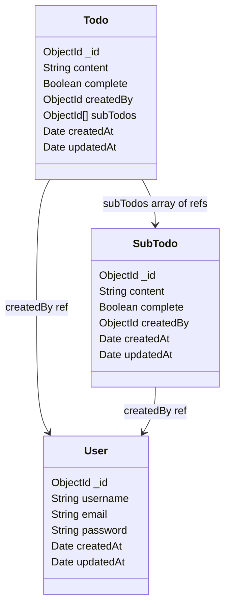

# Final implemented Mongoose models

Reconstructed from 2:37:05–3:05:13, with the uncertainty decisions documented in
[the walkthrough](../docs/tutorial-walkthrough.md). Arrows show stored references,
not enforced foreign keys or exclusive ownership.

| Model | Constraints and defaults |
| --- | --- |
| User | username, email, password required; email lowercase and unique index |
| Todo | content required; complete defaults to false; optional creator; subTodos defaults to an empty array |
| SubTodo | content required; complete defaults to false; optional creator |

All use `timestamps: true`. `_id` is automatically generated by Mongoose.
The default internal version key `__v` is omitted from this teaching diagram.
Collection names are `users`, `todos`, and `subtodos`. No reverse parent field or
automatic parent completion is added.
