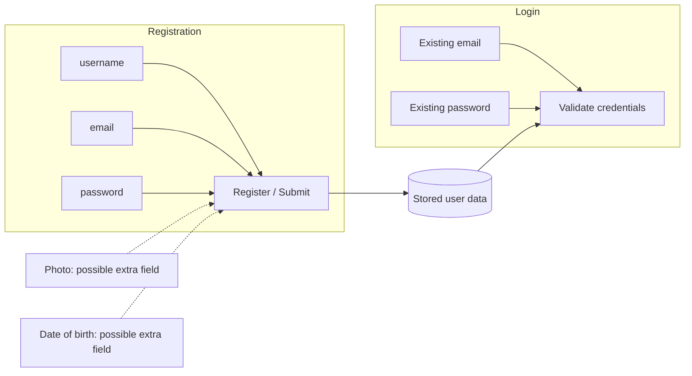
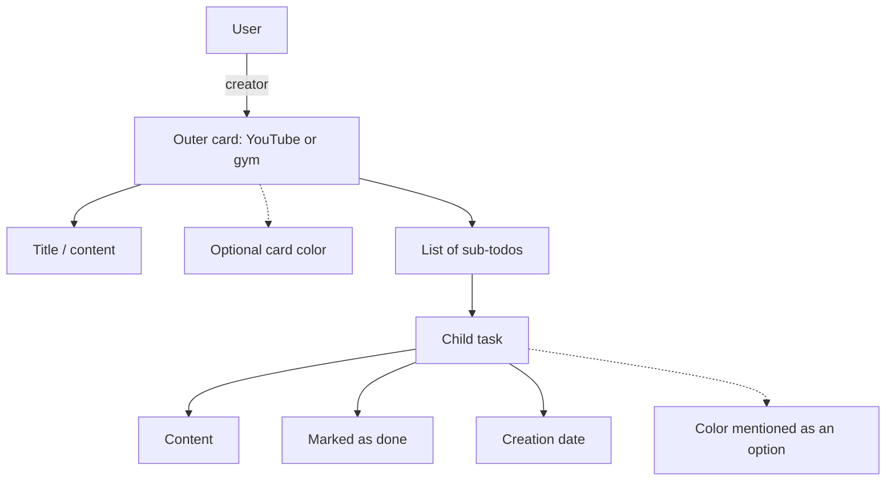

# Planning sketches before coding

These are local equivalents of the narrated exercises, not replicas of the
instructor's unseen screen layout or Eraser's stock diagram.

## Registration and login (2:18:53–2:21:50)

Photo and DOB illustrate changing requirements; neither becomes a final User
field. This sketch describes data inputs, not implemented authentication.

## Todo cards (2:21:58–2:27:38)

The sketch discusses an array of objects. Later code selects references to
separate SubTodo documents. See [final models](models.md) for that final form.
